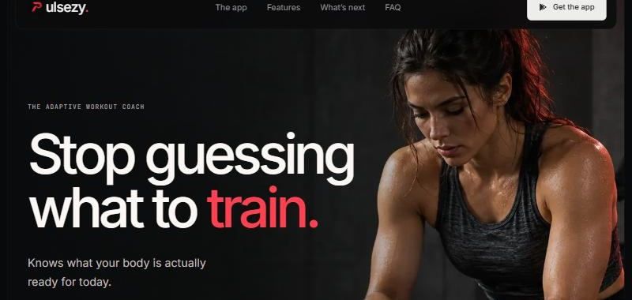
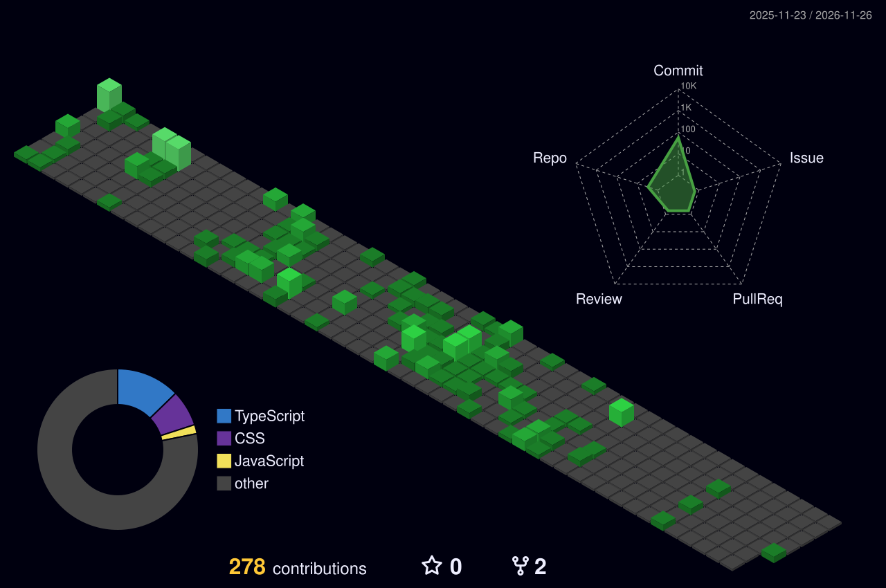

  

  
  
  
  

  

---

## 🛠 What I've shipped

<table>
<tr>
<td width="46%" valign="top">
  
</td>
<td valign="top">

### [Pulsezy](https://pulsezy.app) · my own product
An adaptive fitness app on **Google Play**. It builds each workout from the user's goals, history and recovery, then adjusts as they train.

**I built all of it:** the React Native app, the Supabase backend, subscriptions with RevenueCat + Google Play Billing, and the Play Store release.

`React Native` `Expo` `TypeScript` `Supabase` `RevenueCat`

</td>
</tr>
</table>

<table>
<tr>
<td width="50%" valign="top">

### 💬 Embeddable AI chat widget
**14-day contract · US SaaS client**

A chat widget any website adds with one script tag, streaming AI replies in real time.

- iframe isolation so host-site CSS can't break it
- Theming through CSS variables
- One UMD/IIFE bundle that loads anywhere
- Session handling, chat history and integration docs

`React 18` `TypeScript` `Vite` `Tailwind` `SSE`

</td>
<td width="50%" valign="top">

### 🎓 Learning management system
**Internship · 5th Dimension Technologies**

A course platform for students, instructors and admins.

- OTP sign-up and role-based access
- Course payments
- Found and fixed failing production email delivery
- Five-person team, and I led two interns

`Next.js` `PostgreSQL` `Prisma` `Neon`

</td>
</tr>
</table>

<b>More builds (click to expand)</b>

 

| Project | What it is | Links |
|---|---|---|
| **Snipix** | Workspace for saving and sharing code snippets, with search · Next.js, Express, MongoDB | [Live](https://snipix.vercel.app/) · [Code](https://github.com/Rakeshvanam6868/Snipix) |
| **Spiron.ai** | Next.js + TypeScript web app | [Live](https://spironai.vercel.app/) · [Code](https://github.com/Rakeshvanam6868/Spiron-ai) |
| **Value Hunter** | Next.js web app | [Live](https://value-hunter.vercel.app/) · [Code](https://github.com/Rakeshvanam6868/ValueHunter) |
| **FastGrid** | JavaScript web app | [Live](https://fast-grid-beige.vercel.app/) · [Code](https://github.com/Rakeshvanam6868/FastGrid) |

---

## ⚡ What I work with

  

<b>Details by layer</b>

 

| Layer | Tools |
|---|---|
| 📱 Mobile | React Native, Expo, RevenueCat, Google Play Billing |
| 🖥 Web UI | React, Next.js, TypeScript, Tailwind CSS |
| 🔌 API | Node.js, Express, REST, auth, role-based access, payments, LLM APIs, SSE streaming |
| 🗄 Data | PostgreSQL, Prisma, Supabase, MongoDB, Neon |

300+ LeetCode problems solved.

---

## 📈 Contributions in 3D

  

---

  <b>Looking for an engineer who ships?</b> I'm open to full-time roles, paid trials and contract work. 
  <a href="mailto:rakeshvanam2002@gmail.com">rakeshvanam2002@gmail.com</a> · <a href="https://rakesh-vanam.vercel.app/">rakesh-vanam.vercel.app</a>

